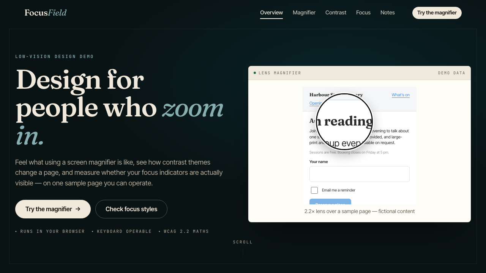
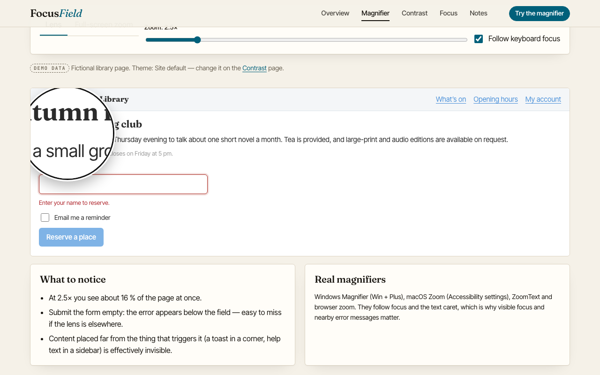
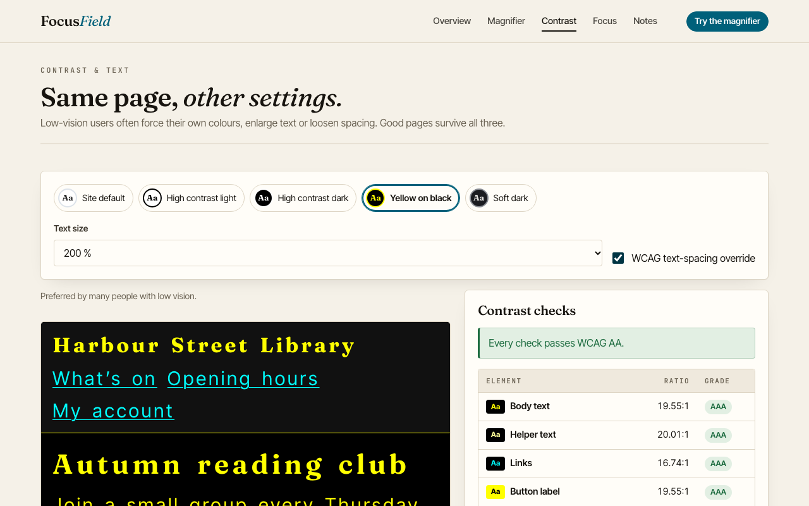
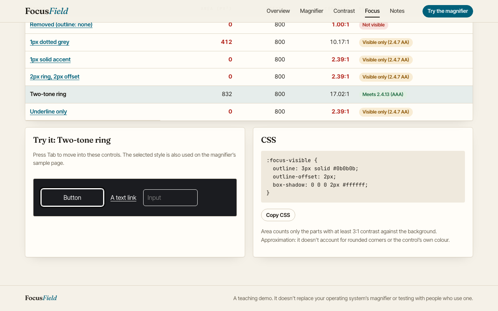

# Focus Field

A low-vision design demo. Use a lens or full-screen magnifier on a sample page, switch it between high-contrast themes with live WCAG contrast checks, and measure focus indicators against the WCAG 2.2 focus-appearance rules.

**Live demo:** [https://focus-field-demo.vercel.app/](https://focus-field-demo.vercel.app/) — runs entirely in your browser.



| Magnifier | Contrast themes | Focus indicators |
| --- | --- | --- |
|  |  |  |

## Run it

```bash
npm install
npm run dev        # http://localhost:5225
npm test
npm run build
npm run test:e2e   # Playwright smoke test (npm run e2e:install once if Chromium is missing)
```

## Main workflow

1. **Magnifier** → choose **Lens** or **Full-screen zoom** and a level from 1.5× to 8×. Move with the pointer, or focus the stage and use the arrow keys (Shift for bigger steps, + and − to zoom).
2. With **Follow keyboard focus** on, tabbing through the sample form moves the lens onto the focused control, or pans the zoomed view by the smallest amount that shows it. A minimap shows where you are.
3. Submit the sample form empty to see how easy it is to miss an error that appears outside the magnified area.
4. **Contrast** → switch between five themes, text at 100–200 % and the WCAG text-spacing override; a table grades body text, helper text, links, button labels and input borders.
5. **Focus** → set the control size and page background; six focus styles are measured for area and contrast, with a live demo you can Tab through and copyable CSS. The chosen style is used on the magnifier’s sample page too.
6. Settings persist in this browser.

## Rules

- Contrast follows WCAG 2.2: text 4.5:1 (AA) and 7:1 (AAA), large text 3:1 and 4.5:1, UI components 3:1.
- Focus appearance (2.4.13): the indicator area must be at least that of a 2 px perimeter of the control (`w·h − (w−4)(h−4)`), and only parts with at least 3:1 contrast against the background count.
- An indicator with some visible part but below that bar is “visible only” (2.4.7 AA); none at all is “not visible”.
- Full-screen zoom pans to keep focus in view with a 16 px margin, aligning large targets to their start.

## Design

Shared editorial system: Fraunces display type, Inter Tight interface text, a deep teal accent, an ink hero with a live lens drifting over the sample page, and a warm paper workspace. The lens is an inert, aria-hidden copy of the page that mirrors its state. Motion is removed under `prefers-reduced-motion`.

## Tests

- `src/lib/a11y.test.ts` — zoom clamping, lens transform, keyboard movement, pan limits, pointer panning, follow-focus panning, contrast ratios and grades, theme checks, ring area, the 2.4.13 minimum, and every focus style on light and dark backgrounds.
- `src/App.test.tsx` — keyboard zoom and mode switching, sample-form validation mirrored in the lens, theme grading with text size and spacing, focus measurements responding to background and size validation.
- `e2e/smoke.spec.ts` — hero lens, lens follow-focus, full-screen zoom keeping a focused field in view, themes at 200 %, focus styles with reload persistence, plus 375px layout checks.

## Limitations

- A browser simulation of the experience, not a replacement for OS magnifiers or testing with people who use them.
- The focus-area calculation ignores rounded corners and the control’s own fill colour.
- Contrast is checked for the sample’s design tokens, not arbitrary pages.

## Future improvements

- Caret tracking inside text inputs, and a docked magnifier mode.
- Check a pasted URL’s colours.

## Licence

MIT — see [LICENSE](LICENSE).
